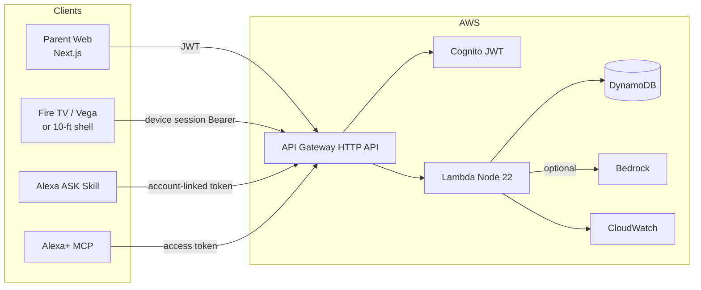
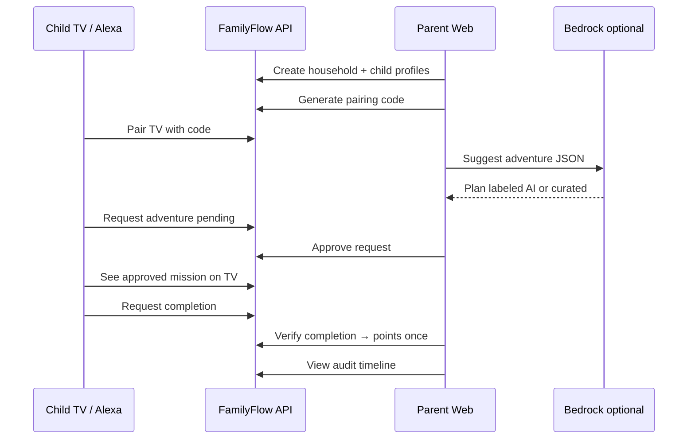

# FamilyFlow AI

**Less scrolling. More living together.**

FamilyFlow is a family coordination and adventure product for the [Amazon Devices Hackathon 2026](https://amazonappdev2026.devpost.com/). Parents and kids browse age-banded adventures on the living-room screen, request them by Fire TV / Vega or Alexa, and parents approve every sensitive step in one **unified web dashboard**. Completions unlock **non-purchasable** family rewards. Optional **Amazon Bedrock** suggestions stay parent-reviewable and never bypass approval.

**Privacy boundary:** Parents see **FamilyFlow activity only** — not unrelated Alexa conversations, Amazon purchases, or third-party Fire TV apps.

**GitHub:** https://github.com/LightLLM/FamilyFlow-AI  
**Owner:** LightLLM · **Last status update:** 2026-10-23

---

## What’s finished (live status)

### Repository

- Public repo pushed: https://github.com/LightLLM/FamilyFlow-AI (`main`)
- Monorepo: parent web, Fire TV shell, Alexa skill, Alexa+ MCP, API, domain/shared packages, CDK infra

### Automated tests (2026-10-23)

| Suite | Result |
|-------|--------|
| Unit — domain, API, fire-tv, alexa, alexa-plus-mcp | **PASS 28/28** |
| E2E — API + Fire TV device session + Alexa local handlers | **PASS 17/17** (`scripts/e2e-fire-tv-alexa.sh`) |
| Vega Virtual Device / physical Fire TV | **Not executed** (needs Apple Silicon + VDT) |
| Alexa Console simulator (launch) | **PASS** — `open family flow` returns Welcome speech |

### AWS sandbox — deployed (`FamilyFlowSandbox`, us-east-1, account `134553439892`)

| Output | Value |
|--------|-------|
| API | https://tyyke5nlm3.execute-api.us-east-1.amazonaws.com |
| Health | `GET /health` → `{"ok":true,"mode":"aws","product":"FamilyFlow AI"}` |
| Cognito User Pool | `us-east-1_0ifoFYaCz` |
| Cognito App Client | `2osuui7r8vsnrbv6l9lhkdtugl` |
| Cognito Hosted UI | https://familyflow-134553439892.auth.us-east-1.amazoncognito.com |
| DynamoDB table | `FamilyFlowSandbox-FamilyFlowTable9CF27E1C-WP4DTW24L7GN` |
| API Lambda | Node 22 · `FAMILYFLOW_MODE=aws` · `ALLOW_LOCAL_DEV_AUTH=false` |
| Alexa skill Lambda | `arn:aws:lambda:us-east-1:134553439892:function:FamilyFlowSandbox-AlexaSkillFn2AEF2519-n5kQoGba5n5o` |
| Budget alert | $25/month (`FamilyFlowSandboxBudget`) |

Production-aligned API Gateway:

- Cognito JWT on parent routes
- Device session routes (`/devices/*`, mission request/complete) open at gateway; **device bearer verified in Lambda** (no parent passwords on TV)

Reviewer Cognito parent user: `parent@familyflow.demo` (password held by operator — not committed).

### Alexa Developer Console — skill created

| Field | Value |
|-------|--------|
| Skill name | FamilyFlow |
| Skill ID | `amzn1.ask.skill.ffe35052-4f43-45e1-96b1-836ac69ff352` |
| Type | Custom · Provision your own |
| Invocation | `family flow` |
| Endpoint | Alexa skill Lambda above (invoke permission scoped to this skill ID) |
| Interaction model | Uploaded from `apps/alexa/skill-package/interactionModels/custom/en-US.json` |
| Console | [Open skill](https://developer.amazon.com/alexa/console/ask/build/custom/amzn1.ask.skill.ffe35052-4f43-45e1-96b1-836ac69ff352/development/en_US/dashboard) |
| Simulator check | Development testing on · launch utterance succeeded |

### Still remaining (owner)

1. **Alexa account linking** (Build → Account linking) → Cognito OAuth  
   - Auth: `{CognitoHostedUI}/oauth2/authorize`  
   - Token: `{CognitoHostedUI}/oauth2/token`  
   - Client ID: `2osuui7r8vsnrbv6l9lhkdtugl` · scopes `openid email profile`  
   - Copy Alexa Redirect URLs into Cognito app client callbacks  
2. Linked-account simulator: `suggest an adventure` / `request the adventure` → parent approve on web  
3. **Fire TV / Vega Appstore** binary on Apple Silicon + device test (browser shell is not an Appstore binary)  
4. Host parent web on HTTPS; extend CORS beyond localhost  

Full checklist: [`docs/DEPLOYMENT_STATUS.md`](docs/DEPLOYMENT_STATUS.md) · publish guide: [`docs/AMAZON_PUBLISH_GUIDE.md`](docs/AMAZON_PUBLISH_GUIDE.md)

---

## Tech stack

| Layer | Technology |
|-------|------------|
| Parent unified web | Next.js App Router, Tailwind CSS, TypeScript |
| Living-room client | Fire TV / Vega OS target; browser 10-ft shell for API/D-pad integration; official VVD for simulator demo |
| Voice | Alexa custom skill (ASK SDK) + Alexa+ MCP preview server |
| API | AWS API Gateway HTTP API → Lambda (Node.js 22) |
| Auth | Amazon Cognito (parents); hashed TV pairing codes + device session tokens |
| Data | DynamoDB single-table (on-demand) |
| AI | Amazon Bedrock Converse (JSON schema + safety checks) + curated fallback library |
| Infra | AWS CDK v2, CloudWatch logs, AWS Budgets |
| Monorepo | pnpm workspaces, TypeScript |
| Local demo | In-memory or DynamoDB Local; `Bearer local:…` **dev only** |

---

## Workflow diagram



### Happy-path sequence



---

## Monorepo layout

```
apps/parent-web       Unified parent dashboard (approvals, planner, Bedrock suggest, privacy)
apps/fire-tv          10-foot TV shell + Vega publish notes
apps/alexa            ASK custom skill + local simulator
apps/alexa-plus-mcp   MCP server for Alexa+ / agentic preview
services/api          HTTP API (local + Lambda)
packages/shared       Types, Zod schemas, DynamoDB keys
packages/domain       Approvals, pairing, points-once, AI safety, audit sanitize
infra                 CDK: Cognito, DynamoDB, HTTP API, Lambda, budget
curated-missions      Safe fallback adventure library
docs/                 Architecture, security, privacy, publish, Bedrock, testing
scripts/              verify-environment, run-tests, e2e-fire-tv-alexa
```

---

## Quick start (local)

```bash
./.tools/pnpm-bin install          # or: pnpm install
./.tools/pnpm-bin --filter @familyflow/shared build
./.tools/pnpm-bin --filter @familyflow/domain build

# Terminal 1 — API
./.tools/pnpm-bin --filter @familyflow/api start

# Terminal 2 — Parent web  → http://localhost:3000
./.tools/pnpm-bin --filter @familyflow/parent-web dev

# Terminal 3 — TV shell     → http://127.0.0.1:3200
./.tools/pnpm-bin --filter @familyflow/fire-tv start
```

Local auth (development only): `Authorization: Bearer local:local-parent-001`

---

## Testing Fire TV / Vega / Alexa

| Path | How |
|------|-----|
| Automated E2E | `bash scripts/e2e-fire-tv-alexa.sh` (API + device session + Alexa handlers) |
| Unit / domain | `bash scripts/run-tests.sh` |
| Fire TV browser shell | `:3200` after pair code from dashboard |
| **Vega Virtual Device** | Install VDT → `vega virtual-device start` → run Vega-packaged app (see below) |
| **Alexa Developer Console** | Skill live (see status above); finish Cognito account linking, then simulator |
| Alexa local | `pnpm --filter @familyflow/alexa simulate:local RequestAdventure` |
| Alexa+ MCP | `pnpm --filter @familyflow/alexa-plus-mcp start` → `http://127.0.0.1:3300/mcp` |
| Bedrock | Enable model access → `BEDROCK_ENABLED=true` → Suggest in planner |

Full guide: [`docs/TESTING_FIRE_TV_VEGA_ALEXA.md`](docs/TESTING_FIRE_TV_VEGA_ALEXA.md)

### Vega Virtual Device (official Fire TV simulator)

```bash
curl -fsSL https://sdk-installer.vega.labcollab.net/get_vvm.sh | bash && source ~/vega/env
vega virtual-device start --display-res=1920,1080
```

Port FamilyFlow TV UI from Amazon RN-TV / Vega samples; call the same pairing + mission APIs. Details: [`docs/AMAZON_PUBLISH_GUIDE.md`](docs/AMAZON_PUBLISH_GUIDE.md).

---

## Amazon Bedrock (valuable family suggestions)

1. AWS Console → Bedrock → request model access (e.g. Nova Lite in your region).  
2. Set `BEDROCK_ENABLED=true`, `BEDROCK_MODEL_ID`, `BEDROCK_REGION`.  
3. Parent planner → **Suggest an adventure** → labeled AI or curated fallback.  
4. Child still needs **request + parent approval**; rewards need **completion approval**.

Guide: [`docs/BEDROCK_SETUP.md`](docs/BEDROCK_SETUP.md)

---

## AWS deploy (your account)

**Already deployed** for LightLLM sandbox — see [What’s finished](#whats-finished-live-status). To redeploy or recreate:

```bash
pnpm --filter @familyflow/api build
pnpm --filter @familyflow/alexa build
cd infra && npx cdk synth
npx cdk deploy FamilyFlowSandbox -c budgetEmail=you@example.com
```

Costs / teardown: [`docs/AWS_COSTS_AND_TEARDOWN.md`](docs/AWS_COSTS_AND_TEARDOWN.md)  
**Do not deploy without reviewing budget.** Default alarm: $25/month.

---

## Publish to Amazon Developer

| Product | Doc |
|---------|-----|
| Fire TV / Vega Appstore | [`docs/AMAZON_PUBLISH_GUIDE.md`](docs/AMAZON_PUBLISH_GUIDE.md) §A |
| Alexa ASK skill | §B |
| Alexa+ MCP | §C |
| Parent web hosting | §D |

---

## Documentation index

| Doc | Purpose |
|-----|---------|
| [`docs/ARCHITECTURE.md`](docs/ARCHITECTURE.md) | System design |
| [`docs/SECURITY.md`](docs/SECURITY.md) | AuthZ, pairing, threats |
| [`docs/PRIVACY_AND_CHILD_SAFETY.md`](docs/PRIVACY_AND_CHILD_SAFETY.md) | Visibility & child safety |
| [`docs/IMPLEMENTATION_STATUS.md`](docs/IMPLEMENTATION_STATUS.md) | 30-step status |
| [`docs/TEST_MATRIX.md`](docs/TEST_MATRIX.md) | Automated vs not executed |
| [`docs/E2E_FIRE_TV_ALEXA_RESULTS.md`](docs/E2E_FIRE_TV_ALEXA_RESULTS.md) | Latest E2E results |
| [`docs/KNOWN_LIMITATIONS.md`](docs/KNOWN_LIMITATIONS.md) | Honest gaps |
| [`docs/HACKATHON_SUBMISSION.md`](docs/HACKATHON_SUBMISSION.md) | Devpost package |
| [`docs/DEPLOYMENT_STATUS.md`](docs/DEPLOYMENT_STATUS.md) | Live AWS + Alexa Console status |
| [`docs/AMAZON_PUBLISH_GUIDE.md`](docs/AMAZON_PUBLISH_GUIDE.md) | Appstore / Alexa / web publish |

---

## Privacy (product commitments)

- No ads, data sales, public child profiles, or child-to-stranger chat  
- Age bands only (no exact birth dates)  
- Export / delete / feature flags / session revocation  
- **Not** a COPPA or legal certification claim without counsel review  
- Do not onboard real children before privacy/security/legal readiness review  

---

## License

MIT — see [`LICENSE`](LICENSE).
